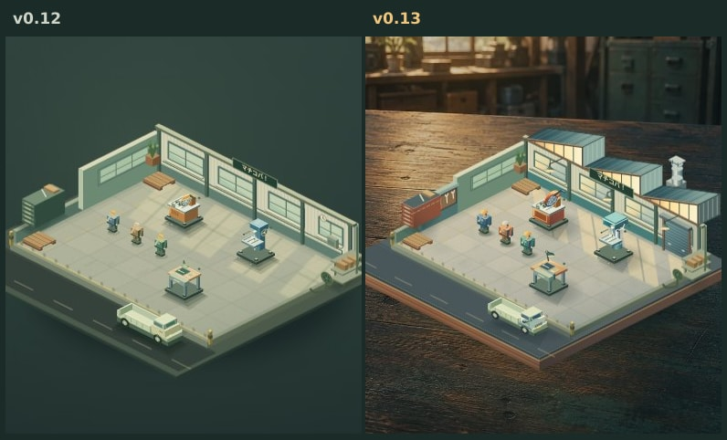

# マチコバ！ v0.13 — 作業台の上の町工場

プレイヤーの「グラフィックを一気に綺麗にしたい」を受け、v0.12 の一枚の作業票で遊ぶ画面に合わせて工場を描き直した。画風の比較元は v0.11 の実画像と v0.12 の390×844の初期・稼働画像。

## 画面

木製の台座、のこぎり屋根、排気筒、吊り照明、工具壁、シャッターと、窓枠が落とす影を追加。切断機の回転砥石とガード、ボール盤の支柱と送りハンドル、旋盤のチャック周り、検品台の照明を改修。職人の帽子、作業服、足元と設備の接地影を調整。部材、担当者、加工・運搬、成長による変化はゲームの状態から描く。

比較は390×844のChromeで、どちらも初期配置、未受注、全景、設備名表示オフ。スクリーンショットの同じ範囲を切り出した。

## 実装と検証

工場は配置・ズーム・拡張に追従するCanvas。実写調の作業台のみCSSの背景に合成する。背景1点は `docs/forge-preview/art/workbench-v013.webp`（820×1230、124,666 bytes）。可動部は描画フレームごとに透明面を消去してから合成する。拡大した機械の形とタップ領域・ラベルの投影をそろえる。セーブはschema 1。

ローカルで69件の既存テストを実行。固定状態の一時停止と動きを抑える設定で描画が一致し、通常稼働ではフレームが変化する。パン後は新しいキャンバスに描いた同じ視点と一致。描画がシミュレーションを書き換えないこと、固定カメラで背景の再構築を繰り返さないことを確認。CIは320×568と390×844のChromeで実画像の読込、ズーム往復、盤上での設備選択と受注から出荷までを検証する。

## 背景原画

Built-in ImageGen。以下の指示で作成し、WebPに変換した。

> Use case: stylized-concept. Create a portrait environmental background plate for an original, beautifully crafted 3D miniature Japanese machine-shop management game. The player’s isometric miniature will be rendered separately on top of this image. This plate shows ONLY the EMPTY real maker’s workbench on which a scale model will rest. Camera looks down at the desk from 32 degrees above, medium macro lens. The desk TABLETOP occupies the lower 78 percent of the entire composition, extends completely to all image edges, absolutely CLEAR and continuous, dark muted smoked walnut and desaturated teal patina, rich yet subtle grain and scratches. Softly lit central oval of the tabletop. At the very top 20 percent only, heavily defocused beyond the back of the bench: a recognizable Japanese atelier wall with soft multi-pane factory window light, indistinct shelving and vague aged green steel cabinets. No objects on the desk, no miniature, no base/platform, no sheet of paper, no vehicles, no people, no focal tool, no writing, no text or logos. Warm honey-colored morning window light from upper left, cool deep teal shadows at right and bottom, subtle natural film texture, controlled cinematic depth of field. Cozy deliberate handcrafted premium game art, subtle painted texture on a physically lit stylized 3D render. Quiet atmosphere and muted contrast so the foreground interactive model will be the hero. Portrait 2:3 aspect ratio, full bleed. This is a reusable game ENVIRONMENT, never a user interface or a poster.

実機iPhone/Safariの性能・発熱、更新後のプレイヤー評価は未確認。

