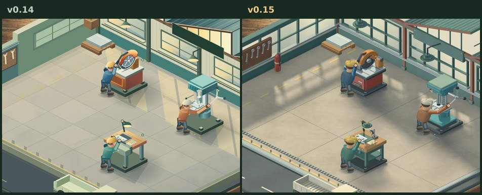

# マチコバ！ v0.15 — 工場の立体描画

v0.14 の8×6工場に最初の注文を入れ、工場時間37.5秒の配置と作業をそろえて比較した。量産品としての品質判定には実機とプレイヤーによる評価が残る。



## 描画と素材

- 独自の立体形状から、塗装した鋳物、磨いた金属、木材、ガラス、コンクリートを共通の照明で描画。建物・床・軽トラ・職人の上半身と、切断機、ボール盤、旋盤、検品台が対象。
- 設備の本体は4種類×3段階。動く部分は各設備につき静止1枚と稼働24姿勢。本体→実部品→前側の機構の順で合成し、ハンドルに掛けた手は同じ姿勢番号で投影する。待機・運搬・足運び・出荷はシミュレーションに従う。
- 初期工場と拡張工場は、それぞれの床に荷受け、設備選択、配置マスの座標が一致するように投影した。同時に読み込む部屋は現在のサイズだけ。資材は自サイト内で完結し、画像が取得できないときは既存の手続き描画で操作を継続する。

## 再生成

リポジトリ直下から次のコマンドを実行する。Python、NumPy、Pillow（WebP）、OpenMP対応のC++17コンパイラを使用。ソースは `art-source/`、中間データは第1引数、ゲーム用WebPと投影矩形は第2引数に出力する。

```sh
python factory-prototype/art-source/miniature.py /tmp/machikoba-art docs/forge-preview/art
```

## 検証

通常倍率と拡大、初期と拡張、職人の手、部材の前後関係を確認した。73件のローカルテストには画像内の矩形と稼働姿勢の一周を含む。固定状態での静止・動きを抑える設定・カメラの往復で画像一致、描画によるセーブ変化なし。ブラウザ検証は通常の受注から出荷、稼働中セーブ、拡張・最高レベル・旋盤、および画像取得失敗からの出荷を扱う。CIの結果と実機Safariの計測は区別する。
